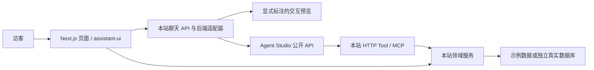

> 历史架构草案。当前实现、选型和启动方式请以根目录 README 为准。

# Demo Hub

独立的产品与 Demo 展示站。暂用 Demo Hub 作为项目名，视觉方向为简洁、明亮的产品站。

当前状态：已完成模板与聊天组件选型、架构草案；尚未搭建应用、安装项目依赖或连接任何后端。

## 产品范围

- 主页介绍本站用途、项目与可体验的 Demo。
- 项目详情展示项目描述、截图和 Demo 入口，Agent Studio 是其中一个项目。
- 多个 Demo 使用各自的页面和聊天入口，支持同一 Demo 下的多个会话。
- 自有后端提供演示数据和 HTTP Tool / MCP 工具，可以从本地示例数据切换到真实数据源。
- Agent Studio 是可替换的后端集成，通过公开 API 使用，不共享代码、数据库或环境文件。

## 架构与视觉候选

架构已认可。2026-10-16 更新：聊天优先 GPT 风格；官网继续比较多种视觉方向，尚未定稿。最新候选与实际预览截图见 [风格候选对照](docs/style-options.md)。

| 部分 | 选择 | 来源 |
| --- | --- | --- |
| 前后端框架 | Next.js App Router、React、TypeScript，Node.js 部署 | https://nextjs.org/docs/app/getting-started/route-handlers |
| 主页 | 待用户选定；重点比较 Launch UI、Cruip Gray、Zolt，保留 Tailark Mist 为参考 | [最新候选](docs/style-options.md) |
| 主页代码与许可证 | tailark/blocks，MIT；实施时固定上游提交并保留许可 | https://github.com/tailark/blocks |
| 聊天 | assistant-ui，优先官方 ChatGPT 示例；独立品牌，保留多 Demo 与多会话能力 | https://www.assistant-ui.com/examples/chatgpt |
| 聊天代码与许可证 | assistant-ui/assistant-ui，MIT；复用消息、输入、多会话、Markdown 和工具展示组件 | https://github.com/assistant-ui/assistant-ui |
| MCP | 官方 TypeScript SDK；实施时选择与 Agent Studio 客户端验证兼容的版本 | https://github.com/modelcontextprotocol/typescript-sdk |

候选中包含开源区块、完整免费模板和付费模板，范围在对照文档中分别标注。尚未购买任何素材或采用付费代码。已在浏览器查看候选首屏；没有登录第三方账号或验证真实模型调用。

## 页面结构

```text
/                        独立品牌首页：简介、精选项目、Demo 入口
/projects                项目列表
/projects/[slug]         项目描述、截图、相关 Demo
/demos                   Demo 列表
/demos/[slug]            Demo 介绍、数据来源、体验入口
/chat/[demoSlug]         当前 Demo 的聊天工作区与会话列表
/api/chat/[demoSlug]     聊天后端适配入口
/api/tools/...           标准 HTTP Tool 接口
/api/mcp                 MCP 工具入口
```

主页不照搬模板内的虚构客户、评价和统计；使用本站真实项目、截图和可体验案例替换。

## 依赖与数据方向



- 页面、HTTP Tool、MCP 共用本站的领域服务，避免分别维护三套业务规则。
- 数据源用 repository 接口替换。首版可从确定性的示例数据开始；需要真实写入时使用本站独立数据库。
- Demo 配置决定其聊天后端和可用能力。未配置 Agent Studio 时，主页、数据展示和明确标注的交互预览仍可独立工作。
- assistant-ui 负责展示与交互。Agent Studio 已有自己的会话和执行协议，接入应使用自定义适配，不能仅因底层用了 LangGraph 就直接套 LangGraph Runtime。
- 会话标识和访客归属由后端验证，按 Demo 与访客隔离。Agent Studio 接入时优先由它保存其会话事实，本站不再维护一套相互冲突的聊天历史。
- Agent Studio 模型调用、工具调度、发布权限仍由 Agent Studio 承担；本站只代理已允许的接口和转换公开事件，不引入第二个 Agent 执行内核。
- 接入密钥只在本站服务端配置，不发给浏览器。公开工具和私有/写入工具分开授权。
- 本地优先以单一 Node.js 服务部署。长期任务、上传和数据库文件在后续部署时配置持久存储，不假定 serverless 文件系统可持久化。

## 首版建议范围

1. 基于最终选定的现成模板完成明亮主页、项目列表和 Demo 列表。
2. 基于 assistant-ui 完成多个 Demo 的聊天入口、流式显示、多会话、取消与错误状态。
3. 完成一组可通过页面、HTTP Tool、MCP 共同读取的示例数据。
4. 实现可配置的 Agent Studio API 适配器；没有凭据时明确展示未连接状态或交互预览，不伪称真实 Agent 回复。
5. 验证类型、生产构建、HTTP/MCP 工具调用、流式取消、会话隔离和桌面/移动布局。

聊天新增对照 Zola、Vercel Chatbot 与 shadcn/chatbot-template；它们偏完整应用，而 assistant-ui 更便于嵌入独立展示站并接入已有 Agent 后端。具体取舍见最新对照文档。
